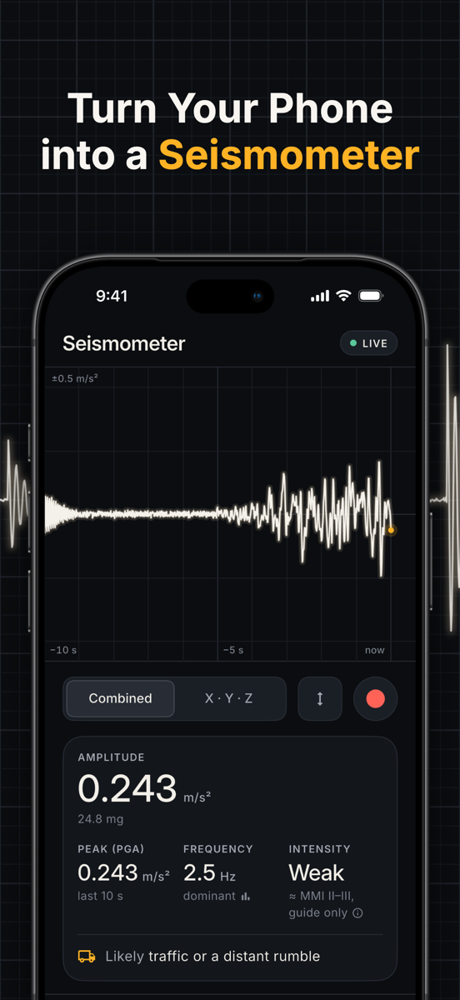
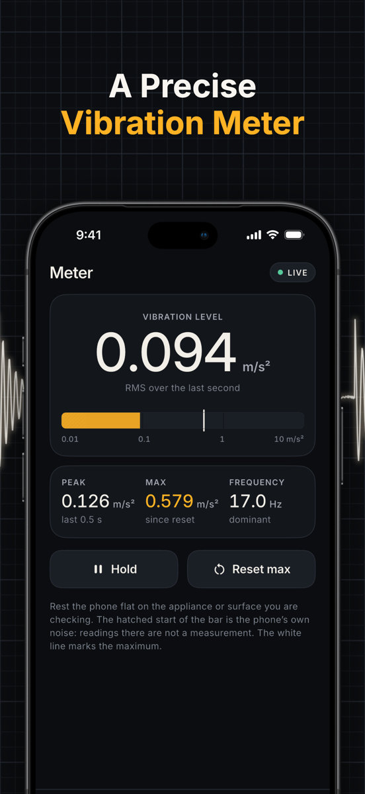
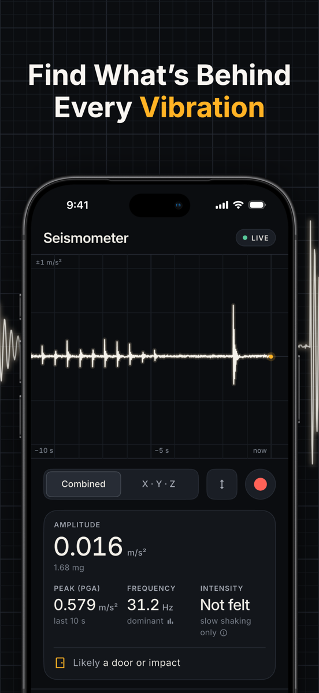
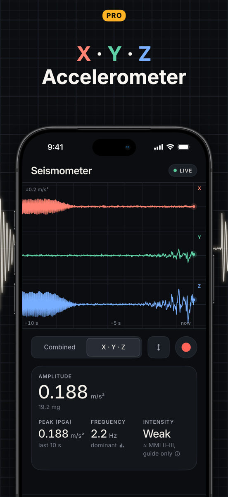
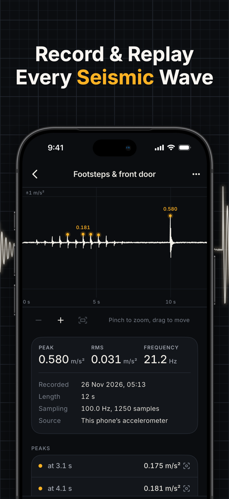
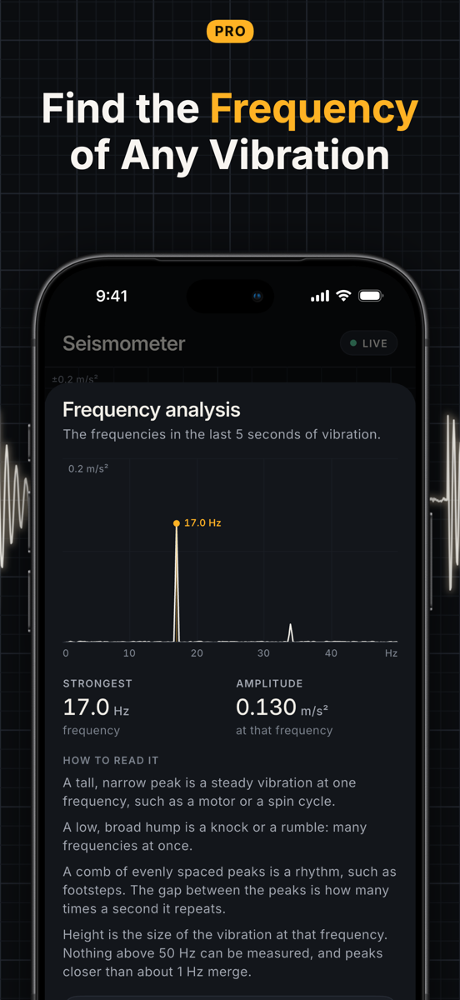
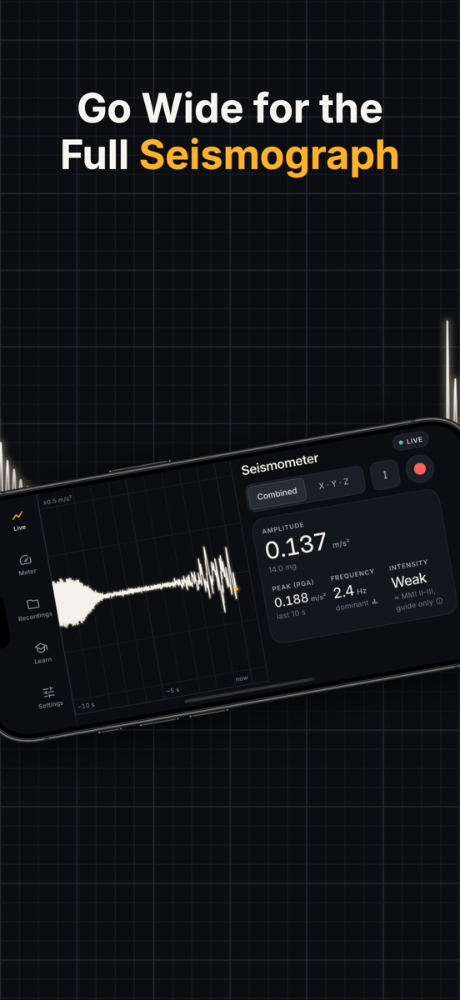
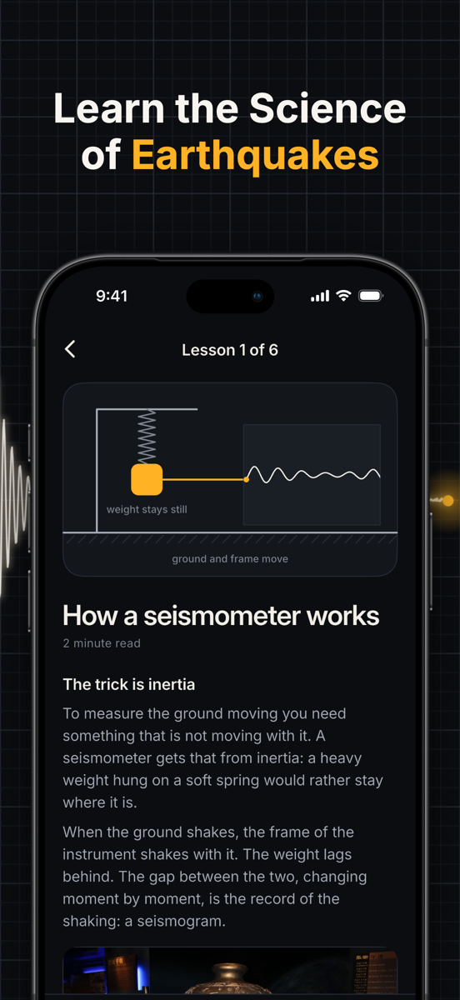

<a href="/apps/" class="back-link">← Back to All Apps</a>

<!-- HERO -->
<section class="hero app-hero" style="background-image: linear-gradient(to bottom, rgba(0,0,0,.5), rgba(0,0,0,.7)), url('{{ page.hero_background }}');">
  

    
    <h1 class="hero-title">Seismometer</h1>
    

      Turn your phone into a live seismograph and see the vibrations around you.
    

    

      TODO at launch: replace this button with <a class="btn btn-primary" href="{{ page.app_store_url }}">Download on the App&nbsp;Store</a>, do the same for the "Get Seismometer" button, and delete the coming-soon popup at the bottom of this file.
      <button type="button" class="btn btn-primary" data-store-trigger aria-haspopup="dialog" aria-controls="store-modal">Download</button>
      <a class="btn btn-ghost" href="#features">See features</a>
      <a class="btn btn-ghost" href="/apps/seismometer/privacy-policy/">Privacy&nbsp;policy</a>
      <a class="btn btn-ghost" href="/apps/seismometer/terms/">Terms&nbsp;of&nbsp;use</a>
      <a class="btn btn-ghost" href="/apps/seismometer/accessibility/">Accessibility</a>
      <a class="btn btn-ghost" href="/apps/seismometer/support/">Support</a>
    

  

  
Photo: <a href="https://commons.wikimedia.org/wiki/File:Seismogram_at_Weston_Observatory.JPG" target="_blank" rel="noopener">a seismograph at Weston Observatory</a> by Z22, <a href="https://creativecommons.org/licenses/by-sa/3.0/" target="_blank" rel="noopener">CC BY-SA 3.0</a>, via Wikimedia Commons

</section>

<!-- SHORT PITCH -->
<section class="section lead">
  

    Seismometer turns your phone's accelerometer into a live seismograph. Put the phone flat on a solid surface and watch footsteps, doors, traffic and washing machines appear as a moving trace, with readings and plain-English explanations of what you're seeing. There's a Meter mode for checking how much an appliance or surface is shaking, and six short lessons on how seismometers work and what their traces mean. It's made for curious people, students and anyone who has wondered what a seismograph actually shows.
  

</section>

<!-- THE SCIENCE -->
<section class="app-section">
  

    <h2>📈 The science behind it</h2>
    

      Seismometer measures the acceleration of the phone itself, on three axes, about 100 times a second. It does not measure the motion of the ground. A phone lying on a table records the table, which is joined to the floor, which is joined to the building, which sits on the ground. Each link filters the motion and often amplifies it, so a tap next to the phone can read more than 1&nbsp;m/s² while the ground under the building doesn't move measurably.
    

    

      Seismometer is a learning tool, not an earthquake detector or a warning system. A resting phone picks up its own electronic noise, which is far larger than the motion of small or distant earthquakes, so they never show up. And no single phone can warn before shaking starts: early warning needs a network of stations near the fault and a way to alert people before the waves arrive. One phone can only show shaking that has already reached it. In an earthquake, always follow official guidance from your local authorities.
    

  

</section>

<!-- CREDENTIALS -->
<section class="app-section">
  

    <h2>🎓 Credentials</h2>
    

      I studied at Durham University in the Department of Earth Sciences. For my third-year research dissertation, I modelled the dynamics of magma with differing crystal fractions, running a numerical model in Cython (Python with C). That research was about magma, not seismology. Seismometer comes from the same Earth science background, and it's written to be plain about what a phone can and can't measure.
    

    
<a href="/dissertation/">Read a plain-English summary of my dissertation →</a>

  

</section>

<!-- FEATURES -->
<section class="app-section" id="features">
  <h2 class="app-section-title">Why you'll love it</h2>
  

    <article class="feature-card fc--cyan">
      
📈

      <h3>Live seismograph</h3>
      
Lay your phone flat and watch every footstep, door and passing lorry as a moving trace of the last 10 seconds. Pro adds separate X, Y and Z traces.

    </article>
    <article class="feature-card fc--amber">
      
🔢

      <h3>Readings that mean something</h3>
      
See the amplitude, peak and dominant frequency, with an intensity guide and a hint at what caused each vibration, all explained in plain English.

    </article>
    <article class="feature-card fc--violet">
      
⏺️

      <h3>Record and replay</h3>
      
Save a recording, then zoom in and move along it to look closer. Free keeps three recordings. Pro keeps as many as you like and exports them as an image or CSV file.

    </article>
    <article class="feature-card fc--green">
      
🎚️

      <h3>Frequency analysis (Pro)</h3>
      
See the full spectrum of a vibration, live or for a whole recording, and tell a steady hum from a knock or the rhythm of footsteps.

    </article>
    <article class="feature-card fc--yellow">
      
🎓

      <h3>Six short lessons</h3>
      
From how a seismometer works and P-waves and S-waves to magnitude vs intensity and why phones can't detect most earthquakes. The first two are free.

    </article>
    <article class="feature-card fc--teal">
      
💎

      <h3>One purchase, no subscription</h3>
      
Free to download. Seismometer Pro is a one-time purchase that unlocks everything for good. No account and no ads.

    </article>
  

</section>

<!-- HOW IT WORKS -->
<section class="app-section">
  <h2 class="app-section-title">How it works</h2>
  <ol class="steps-list">
    <li><strong>Put the phone down flat:</strong> Lay your phone on a solid surface such as a table, floor or worktop. The app tells you if it isn't lying flat and still.</li>
    <li><strong>Watch the trace:</strong> Footsteps, doors, traffic and washing machines appear as a moving trace. Choose Auto, High, Medium or Low sensitivity. Pro adds a custom scale and shows anything from 5 to 60 seconds.</li>
    <li><strong>Read what it means:</strong> See the amplitude, peak and dominant frequency in m/s² or g, with an intensity guide and a hint at the likely source, each explained in plain English.</li>
    <li><strong>Record it and look closer:</strong> Record a vibration, then zoom in and replay it. With Pro, see its frequency spectrum and export it as an image or CSV file.</li>
  </ol>
</section>

<!-- SCREENSHOTS -->
<section class="app-section">
  <h2 class="app-section-title">Screenshots</h2>
  

    
    
    
    
    
    
    
    
  

  
<button type="button" class="btn btn-primary" data-store-trigger aria-haspopup="dialog" aria-controls="store-modal">Get Seismometer</button>

</section>

<!-- FAQ -->
<section class="app-section">
  <h2 class="app-section-title">FAQ</h2>
  

    

      
Can it detect or warn of earthquakes?

      
No. Seismometer is not an earthquake detector or a warning system. A phone's accelerometer picks up its own electronic noise, which is far larger than the motion of small or distant earthquakes, so they don't show up. And no single phone can warn before shaking starts: early warning needs a network of stations near the fault and a way to alert people before the waves arrive. One phone can only show shaking that has already reached it. In an earthquake, always follow official guidance from your local authorities. For information about real earthquakes around the world, try my <a href="/apps/earthquake-tracker/">Earthquake Tracker</a> app.

    

    

      
How accurate is it?

      
Seismometer is only as accurate as your phone's accelerometer, which isn't calibrated as a measuring instrument. It measures the acceleration of the phone itself, not the ground: a phone on a table records the table, which can soften or amplify what the floor and building are doing. The smallest readings are the phone's own noise. Use the readings to learn and to compare one vibration with another, not as official measurements, and don't use them for engineering, structural, workplace or safety decisions.

    

    

      
Does it work offline?

      
Yes. The trace, readings, recordings and lessons all work without an internet connection, and everything is worked out on your device. You only need a connection to buy or restore Pro, and to send usage statistics if you've chosen to share them.

    

    

      
Which devices are supported?

      
Seismometer runs on iPhone and iPad with iOS 16 or later. On iPad it uses the iPhone layout at a larger size. It works with larger text, Bold Text, Increase Contrast, Reduce Motion and VoiceOver. Read the <a href="/apps/seismometer/accessibility/">Accessibility</a> page for the details.

    

    

      
What data does it collect?

      
Very little. There's no account and no sign-up, and the app doesn't use your location, photos, microphone or contacts. The only sensor it reads is the accelerometer, which needs no permission, and your sensor readings and recordings stay on your device. If sharing is on, the app sends a few usage statistics, such as which lesson was opened. These never include a recording or sensor data, and you can turn them off in Settings. Read the <a href="/apps/seismometer/privacy-policy/">Privacy Policy</a> for the details.

    

    

      
How much does it cost?

      
Seismometer is free to download, and everything you need to see and understand vibrations is free. Seismometer Pro is a one-time purchase, not a subscription, and unlocks everything: separate X, Y and Z traces, frequency analysis, unlimited recordings, export, all six lessons and advanced sensitivity. If you reinstall the app or move to a new device, tap "Restore purchases" in Settings to get Pro back.

    

  

</section>

<!-- SUPPORT -->
<section class="app-section">
  

    

      <h3>📧 Support</h3>
      
Questions or feedback? Email <a href="mailto:hello@laurence-wayne.com">hello@laurence-wayne.com</a>, or read the <a href="/apps/seismometer/support/">Support</a> page.

    

    

      <h3>🔄 Version & updates</h3>
      
Version 1.0.0. Last updated: <time datetime="{{ page.last_updated }}">{{ page.last_updated }}</time>. Coming to the App Store soon.

    

  

</section>

<!-- COMING SOON POPUP -->

  

  

    <button type="button" class="store-modal-close" aria-label="Close" data-store-close>&times;</button>
    <h2 class="store-modal-title" id="store-modal-title">📈 Coming soon</h2>
    
Seismometer isn't on the App Store just yet. It will be available for iPhone and iPad soon, so please check back.

    

      <button type="button" class="store-choice" data-store-close style="width: 100%; justify-content: center; font: inherit; cursor: pointer;">
        Got it
      </button>
    

  

