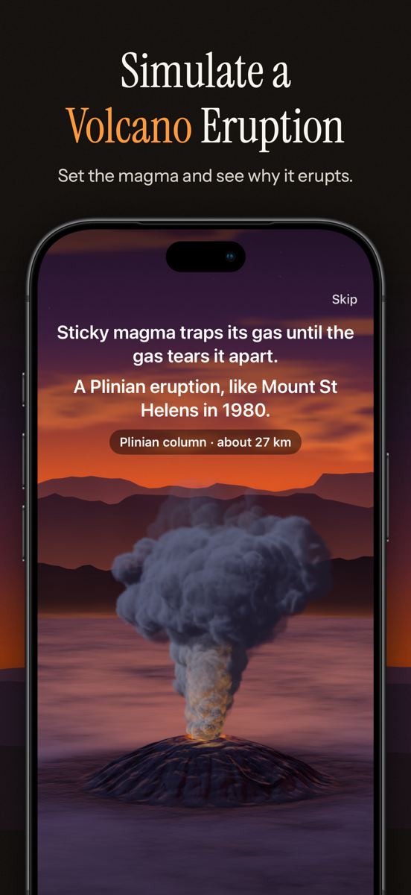
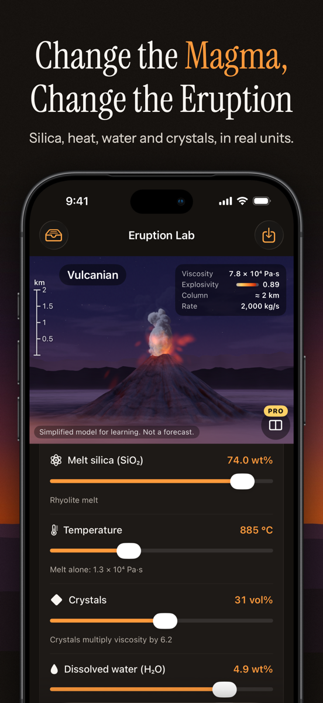
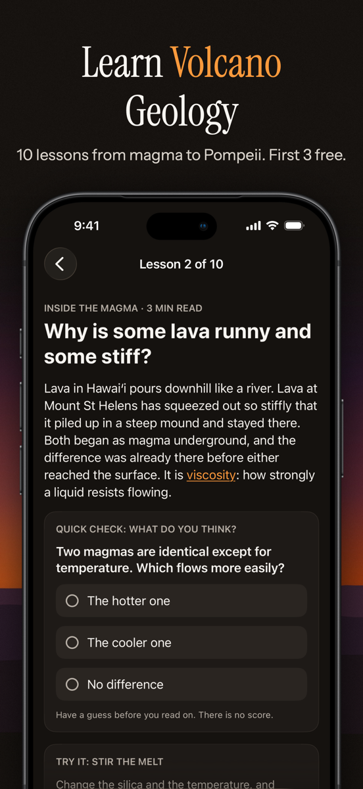
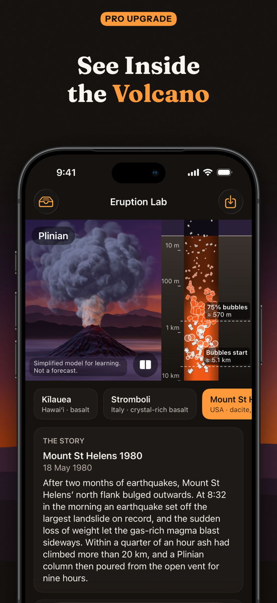
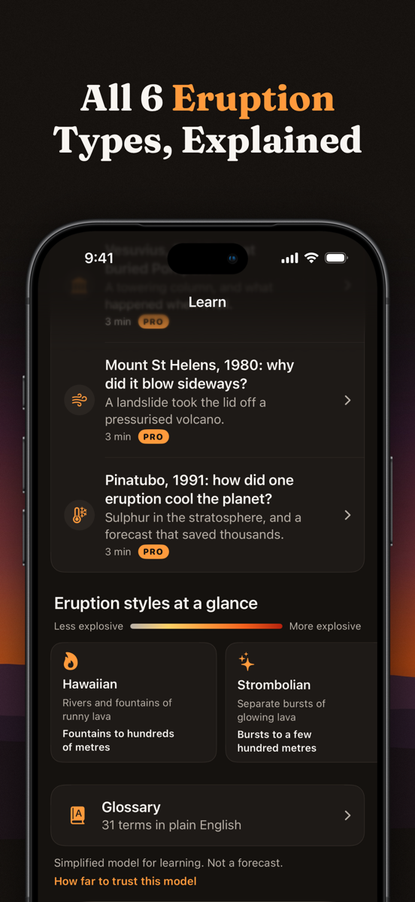
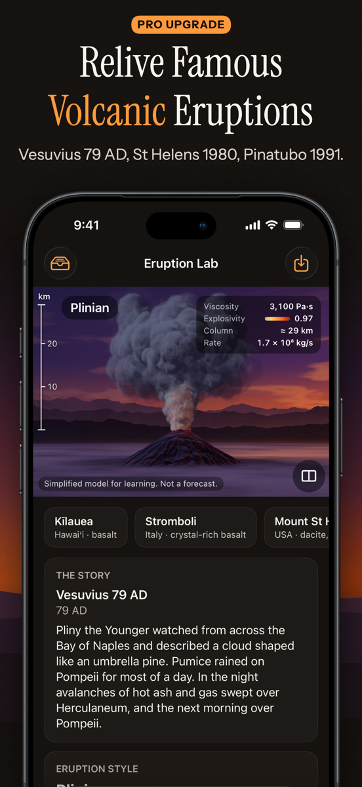
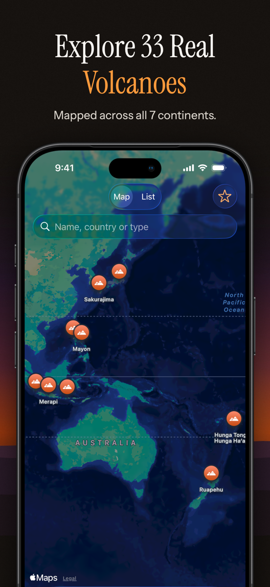

<a href="/apps/" class="back-link">← Back to All Apps</a>

<!-- HERO -->
<section class="hero app-hero" style="background-image: linear-gradient(to bottom, rgba(0,0,0,.25), rgba(0,0,0,.55)), url('{{ page.hero_background }}');">
  

    
    <h1 class="hero-title">Volcano Lab</h1>
    

      Make volcanoes erupt in 3D and discover why some ooze and others explode.
    

    

      TODO at launch: replace this button with <a class="btn btn-primary" href="{{ page.app_store_url }}">Download on the App&nbsp;Store</a>, do the same for the "Get Volcano Lab" button, and delete the coming-soon popup at the bottom of this file.
      <button type="button" class="btn btn-primary" data-store-trigger aria-haspopup="dialog" aria-controls="store-modal">Download</button>
      <a class="btn btn-ghost" href="#features">See features</a>
      <a class="btn btn-ghost" href="/apps/volcano-lab/privacy-policy/">Privacy&nbsp;policy</a>
      <a class="btn btn-ghost" href="/apps/volcano-lab/terms/">Terms&nbsp;of&nbsp;use</a>
      <a class="btn btn-ghost" href="/apps/volcano-lab/support/">Support</a>
    

  

</section>

<!-- SHORT PITCH -->
<section class="section lead">
  

    Volcano Lab puts a volcano in your hands. Turn up the silica, cool the magma, add crystals or dissolved water, and watch what happens next: a gentle lava fountain, a spitting Strombolian burst, or a towering Plinian ash column. Each eruption comes with a plain-English explanation of why it behaved the way it did. It's made for students, teachers and anyone who has ever wondered why some volcanoes ooze while others explode.
  

</section>

<!-- THE SCIENCE -->
<section class="app-section">
  

    <h2>🌋 The science behind it</h2>
    

      Before I built apps, I was a volcano researcher. My research modelled how crystals flowing through magma change the way a volcano erupts: how a magma crowded with crystals can stiffen, clog its conduit and turn what might have been a quiet lava flow into a violent explosion. Volcano Lab grew directly out of that work.
    

    

      The Eruption Lab is built on published volcanology models, including melt viscosity models and crystal-suspension rheology, simplified so that anyone can play with them. Change the magma's ingredients and the app works out how sticky and gas-rich it is, how explosive it is likely to be, and which style of eruption would follow. Volcano Lab is a learning tool, not a forecast: it can't predict real eruptions, and you should always follow your local volcano observatory and civil authorities.
    

  

</section>

<!-- FEATURES -->
<section class="app-section" id="features">
  <h2 class="app-section-title">Why you'll love it</h2>
  

    <article class="feature-card fc--cyan">
      
🌋

      <h3>Eruption Lab in 3D</h3>
      
Orbit and zoom around a 3D volcano, adjust four magma controls and watch anything from lava fountains to towering ash columns.

    </article>
    <article class="feature-card fc--amber">
      
🔍

      <h3>See inside the volcano</h3>
      
Slice it open with the cutaway view (Pro) to see the magma chamber and conduit, with crystals and gas bubbles rising through them.

    </article>
    <article class="feature-card fc--violet">
      
📜

      <h3>Famous eruptions</h3>
      
Recreate Mount St Helens 1980, Vesuvius 79 AD and Pinatubo 1991 (Pro), each with its story. Kīlauea and Stromboli are free.

    </article>
    <article class="feature-card fc--green">
      
🎓

      <h3>Built by a volcanologist</h3>
      
Designed by a former volcano researcher, with real magma physics behind every eruption you create.

    </article>
    <article class="feature-card fc--yellow">
      
🗺️

      <h3>Explore &amp; learn</h3>
      
Browse a map of the world's best-known volcanoes, take bite-sized lessons and try challenges like making a Plinian eruption from basalt.

    </article>
    <article class="feature-card fc--teal">
      
💎

      <h3>One purchase, no subscription</h3>
      
Free to download. Volcano Lab Pro is a one-time purchase that unlocks everything for good. No account and no ads.

    </article>
  

</section>

<!-- HOW IT WORKS -->
<section class="app-section">
  <h2 class="app-section-title">How it works</h2>
  <ol class="steps-list">
    <li><strong>Choose a volcano:</strong> Start with a preset such as Kīlauea or Stromboli, or pick one of the famous eruptions with Pro.</li>
    <li><strong>Adjust the magma:</strong> Set the silica content (SiO2), temperature, crystal content and dissolved water. Pro adds vent radius and eruption rate.</li>
    <li><strong>Watch it erupt:</strong> The app calculates the magma's viscosity and explosivity, then shows the eruption in 3D, from Hawaiian and Strombolian to Vulcanian, Sub-Plinian and Plinian.</li>
    <li><strong>Understand why:</strong> Read a plain-English explanation of why your magma erupted the way it did, and what would change it.</li>
  </ol>
</section>

<!-- SCREENSHOTS -->
<section class="app-section">
  <h2 class="app-section-title">Screenshots</h2>
  

    
    
    
    
    
    
    
  

  
<button type="button" class="btn btn-primary" data-store-trigger aria-haspopup="dialog" aria-controls="store-modal">Get Volcano Lab</button>

</section>

<!-- FAQ -->
<section class="app-section">
  <h2 class="app-section-title">FAQ</h2>
  

    

      
Does Volcano Lab work offline?

      
Yes. Once it's installed, the Eruption Lab, lessons and volcano profiles all work without an internet connection, so it's ideal for classrooms and field trips with patchy signal.

    

    

      
Can Volcano Lab predict real eruptions?

      
No. Volcano Lab is an educational simulator. Its models are based on published volcanology research but simplified for learning, and they don't use live monitoring data such as earthquakes, ground deformation or gas measurements. It can't tell you when or how a real volcano will erupt. For that, always follow official guidance from your local volcano observatory and civil authorities.

    

    

      
Which devices are supported?

      
Volcano Lab runs on iPhone with iOS 18 or later. It supports Dynamic Type, VoiceOver and Reduce Motion.

    

    

      
What data does it collect?

      
Very little. There's no account, no photo uploads and no location tracking, and your saved lab runs and progress stay on your device. Read the <a href="/apps/volcano-lab/privacy-policy/">Privacy Policy</a> for the details.

    

    

      
How much does it cost?

      
Volcano Lab is free to download, with plenty to explore straight away. Volcano Lab Pro is a one-time purchase, not a subscription, and unlocks everything: the cutaway view, famous eruptions, advanced controls, all lessons and all challenges. If you reinstall the app or move to a new iPhone, tap "Restore purchases" in the app to get Pro back.

    

    

      
Is it suitable for students and classrooms?

      
Yes. Volcano Lab was designed as a learning tool, covering the big ideas behind why eruptions differ, from magma viscosity and gas to volcanic hazards. Teachers are very welcome to get in touch at <a href="mailto:hello@laurence-wayne.com">hello@laurence-wayne.com</a>.

    

  

</section>

<!-- SUPPORT -->
<section class="app-section">
  

    

      <h3>📧 Support</h3>
      
Questions or feedback? Email <a href="mailto:hello@laurence-wayne.com">hello@laurence-wayne.com</a>.

    

    

      <h3>🔄 Version & updates</h3>
      
Last updated: <time datetime="{{ page.last_updated }}">{{ page.last_updated }}</time>. Coming to the App Store in the next few days.

    

  

</section>

<!-- COMING SOON POPUP -->

  

  

    <button type="button" class="store-modal-close" aria-label="Close" data-store-close>&times;</button>
    <h2 class="store-modal-title" id="store-modal-title">🌋 Coming very soon</h2>
    
Volcano Lab isn't on the App Store just yet. It will be available for iPhone in the next few days, so please check back soon.

    

      <button type="button" class="store-choice" data-store-close style="width: 100%; justify-content: center; font: inherit; cursor: pointer;">
        Got it
      </button>
    

  

