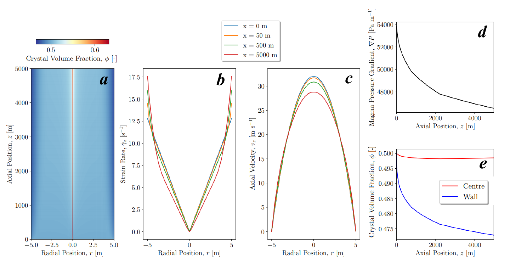
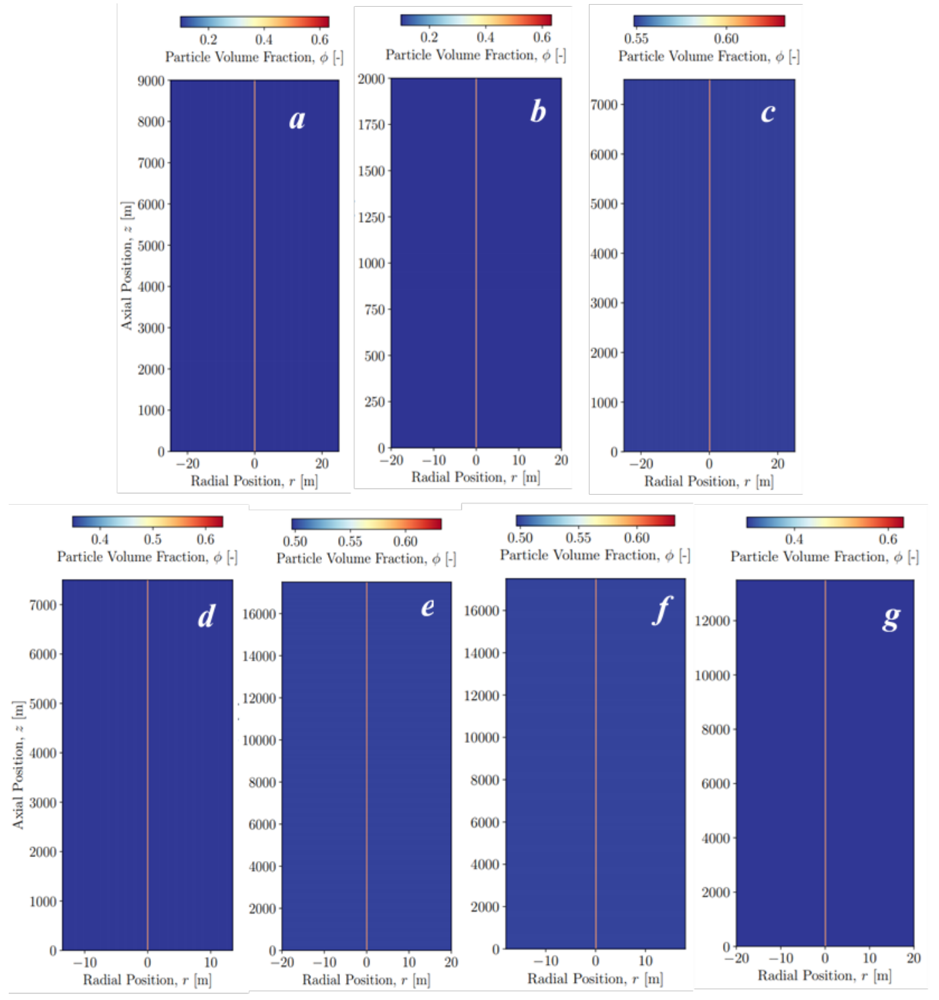

<article class="post dissertation" style="--post-accent: #F97316;">

  <a href="/" class="back-link">← Back to Home</a>

  <header class="post-header">
    <h1 class="post-title">{{ page.title }}</h1>
    
Do crystals crowd towards the middle of rising magma? My third-year dissertation at Durham University, summarised in plain English.

    
Laurence Wayne · BSc Geophysics with Geology · Department of Earth Sciences, Durham University · 2020/21

    <ul class="post-tags">
      <li class="tag">Volcanology</li>
      <li class="tag">Fluid dynamics</li>
      <li class="tag">Numerical modelling</li>
      <li class="tag">Cython</li>
    </ul>
    

      <a class="btn btn-primary" href="{{ page.pdf }}" target="_blank" rel="noopener">Read the dissertation</a>
      <a class="text-link" href="{{ page.pdf }}" download>Download PDF (67 pages, 2.7 MB)</a>
    

  </header>

  

    <h2>The short version</h2>
    
Magma rising through a volcano carries crystals with it. In a narrow pipe, those crystals can drift away from the walls and crowd towards the centre, changing how the whole mixture flows. I tested whether this really happens inside volcanoes. At all seven real volcanoes I modelled, the answer was no: their conduits are far too short for it to develop.

    <dl class="dissertation-stats">
      

        <dt>Real volcanoes modelled</dt>
        <dd>7</dd>
      

      

        <dt>Showed clear crystal migration</dt>
        <dd>0</dd>
      

      

        <dt>How much longer the closest conduit would need to be</dt>
        <dd>328,000×</dd>
      

    </dl>

    <h2>The question</h2>
    
Magma isn't just liquid rock. It's usually a mixture of molten melt and solid crystals, and the way that mixture flows up the conduit, the pipe between a magma chamber and the surface, helps decide the style of an eruption. Conduits are almost impossible to measure directly, so much of what we know about them comes from numerical models.

    
Laboratory experiments had found that crystal-rich magma is <em>non-Newtonian</em>: how easily it flows depends on how fast it's being sheared, a bit like ketchup getting runnier when you shake the bottle. One possible explanation is <strong>crystal migration</strong>. As the mixture flows, crystals jostle against each other and get pushed away from the walls towards the centre, forming a slower-shearing "plug".

    
I set out to answer three questions:

    <ol>
      <li>How much does crystal migration actually happen in real volcanoes?</li>
      <li>What changes when the model's assumptions are challenged?</li>
      <li>What does the answer mean for the way magma flows?</li>
    </ol>

    <h2>How I tested it</h2>
    
I used a physical model of dense suspensions from Lecampion &amp; Garagash (2014), which builds on the friction-based rheology of Boyer et al. (2011). My external supervisor, Dr Jérémie Vasseur, had coded that model, and I ran it using Python and Cython (Python with C) to make its first application to a magmatic setting.

    
For each volcano, I gathered values from published studies: conduit length and radius, crystal content and size, water content, temperature and magma composition. Melt viscosity came from the model of Giordano et al. (2008). The case studies covered basaltic, andesitic and dacitic magmas, including "extreme" examples chosen to give crystal migration the best possible chance.

    <h2>What migration looks like</h2>
    
To see the effect clearly, I first set up a deliberately favourable conduit: just 5 m in radius, filled with runny magma that was 50% crystals, with a crystal size of 1 cm. Here, crystals do drift away from the walls. The concentration at the wall falls while the centre stays close to 0.5 (panel e), and the flow profile starts to flatten (panel c). Conditions like these are unlikely to exist in nature.

    <figure class="dissertation-figure">
      
      <figcaption>The best-case conduit: (a) crystal concentration, (b) strain rate, (c) flow velocity, (d) pressure gradient and (e) crystal fraction at the centre and wall. Figure 4.1 of the dissertation. Select to enlarge.</figcaption>
    </figure>

    <h2>What real volcanoes did</h2>
    
Then I ran the real case studies. Each panel below is a slice through one volcano's conduit, coloured by crystal concentration. If crystals were migrating, you'd see a brighter band down the middle, as in the plot above. Instead, each conduit stays almost perfectly uniform from bottom to top.

    <figure class="dissertation-figure">
      
      <figcaption>Crystal concentration in (a) Mt. Etna, (b) Kīlauea, (c) Unzen, (d) Volcán de Colima, (e) Fish Canyon, (f) Mt. Pelée and (g) Black Butte. Figure 4.2 of the dissertation. Select to enlarge.</figcaption>
    </figure>

    
The reason comes down to distance. The length of conduit needed for migration to fully develop grows with the cube of the conduit's radius and shrinks with the square of the crystal size. For Mt. Etna, that works out at about 1.6 billion km, roughly ten times the distance from the Earth to the Sun. Its conduit is about 9 km long.

    <figure class="length-chart">
      <figcaption class="length-chart-title">Conduit length: what each volcano has, and what migration needs</figcaption>
      <ul class="length-chart-legend" aria-hidden="true">
        <li><i class="length-mark length-mark--actual"></i> Actual length</li>
        <li><i class="length-mark length-mark--needed"></i> Length needed</li>
      </ul>
      

        Moon
        Sun
        
        

          
{{ v.name }}needs {{ v.needed }}

          

            <i class="length-gap" style="--from: {{ v.x_actual }}%; --to: {{ v.x_needed }}%;"></i>
            <i class="length-mark length-mark--actual" style="--x: {{ v.x_actual }}%;"></i>
            <i class="length-mark length-mark--needed" style="--x: {{ v.x_needed }}%;"></i>
          

        

        
        

          1 km
          1,000 km
          1 million km
          1 billion km
        

      

      
Logarithmic scale: each axis label is 1,000 times the last. "Moon" and "Sun" mark their distance from Earth. Needed length uses the dissertation's estimate, R³/a². Even if migration developed in a tenth of that distance, every volcano would still fall short by more than 30,000 times.

      

        
View the data as a table

        

          <table>
            <thead>
              <tr><th scope="col">Volcano</th><th scope="col">Radius</th><th scope="col">Crystal size</th><th scope="col">Actual length</th><th scope="col">Length needed</th><th scope="col">Times longer</th></tr>
            </thead>
            <tbody>
              
              <tr><th scope="row">{{ v.name }}</th><td>{{ v.radius }}</td><td>{{ v.crystal }}</td><td>{{ v.actual }}</td><td>{{ v.needed }}</td><td>{{ v.shortfall }}</td></tr>
              
            </tbody>
          </table>
        

      

    </figure>

    <h2>Why it matters</h2>
    
A "no" turned out to be the interesting result. If crystals aren't migrating at the scale of a real conduit, crystal-bearing magma may behave as a simple Newtonian fluid at that scale. I argued that the non-Newtonian behaviour seen in small laboratory samples could be an experimental artefact of crystals migrating in those samples, and so shouldn't be scaled up to whole volcanoes.

    
If that's right, models of magma ascent that assume non-Newtonian flow may need revisiting, along with ideas that depend on strain being concentrated at the conduit walls, such as viscous heating and fracturing at the conduit margins.

    <h2>The caveats</h2>
    <ul>
      <li><strong>Crystals were treated as spheres.</strong> Real crystals can be long or flat, which could change the distance needed for migration.</li>
      <li><strong>Bubbles were left out.</strong> Gas bubbles in rising magma would change its viscosity, making migration either easier or harder.</li>
      <li><strong>The flow was steady.</strong> The model assumes magma enters the conduit at a constant speed, which won't always be true.</li>
      <li><strong>Seven volcanoes aren't every volcano.</strong> They were chosen to represent different magma types and to give migration its best chance, but they can't cover every setting on Earth.</li>
    </ul>
    
This was an undergraduate research project, and these are the conclusions I reached at the time.

    <h2>From dissertation to Volcano Lab</h2>
    
Many of the equations from this work sit behind <a href="/apps/volcano-lab/">Volcano Lab</a>, my iPhone app for exploring why eruptions behave the way they do. Change the crystal content in the app and you can see what it does to viscosity and eruption style. It's a simplified learning tool rather than a forecast.

    
<strong>About this online version:</strong> to respect other people's copyright, I've removed the code appendix and 11 figures reproduced from published papers. Each removed figure keeps its caption and citation, so you can find it in the original source. All of my own writing, results and model plots are included.

    

      <a class="btn btn-primary" href="{{ page.pdf }}" target="_blank" rel="noopener">Read the dissertation</a>
      <a class="text-link" href="/apps/volcano-lab/">Explore Volcano Lab →</a>
    

  

</article>
